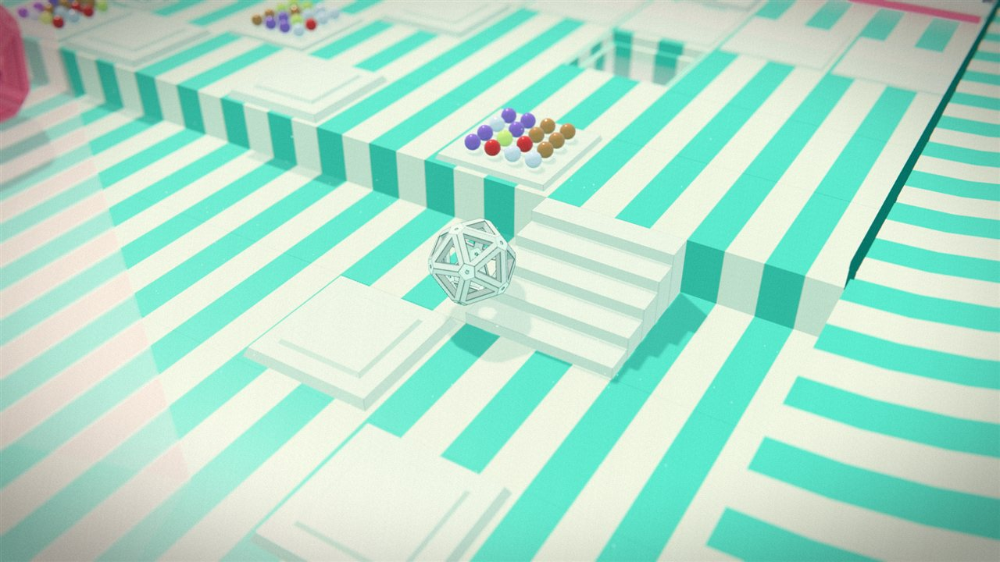

# Digiplanes

A small Three.js browser game drawn like a technical drawing. You roll a wireframe cage across
15 themed planes, each with its own palette and its own soundtrack.


| Bubblegum | Puzzle mode |
|---|---|
|  |  |

- **Cage** mode: scoop up marbles (12 at most) and roll them into the lit portal to bank them.
  Banking refuels the clock, and a full load scores ×2. The hunter cage gets faster after every
  bank, so ram the chrome balls into it to stun it.
- **Puzzle** mode: the cage tips face by face over a triangle grid. Land the glowing face on the
  glowing target.

## Run it

It is plain static files with no build step. three.js 0.169.0 is loaded from the jsDelivr CDN, so
you need an internet connection.

```bash
node server.js
```

Then open http://localhost:5173. Any static server works too, including GitHub Pages under a
subpath (`https://<user>.github.io/<repo>/`). `server.js` adds two dev-only extras:
`game.shot(name)` saves screenshots to `shots/`, and missing music files get a quiet 204.

URL options: `?plane=3` starts on plane 3, `#puzzle` opens Puzzle mode, and `?silent` turns off audio.

## Controls

| | Cage | Puzzle |
|---|---|---|
| Move | WASD, or hold left-click and drag | WASD or click to tip |
| Action | Space or right-click to hop | Z undo · N skip |
| Retry | R | R |

`1` / `2` switch modes, `[` / `]` change plane, and `M` mutes (remembered between visits).

## Music and the Glass FM synth

Each plane plays `music/<plane>.mp3` if you add one. Otherwise it plays the plane's Glass FM song,
`music/fm/<plane>.js`, live on a small Web Audio FM synth (`synth/engine.js`). See
`music/README.txt` for the plane ids.

**Glass FM** (`synth/index.html`, the ♪ SYNTH tab in the game) is the synth on its own page. Its
playlist holds all 15 plane songs, so you can audition them, play the synth from the keyboard and
tweak patches.

After editing a song, check it for structural and harmonic problems:

```bash
node music/fm/check.js
```
